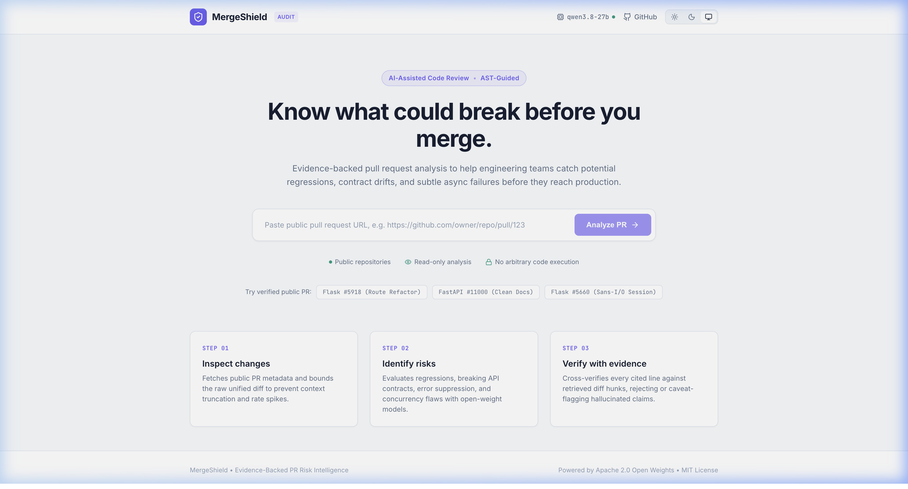
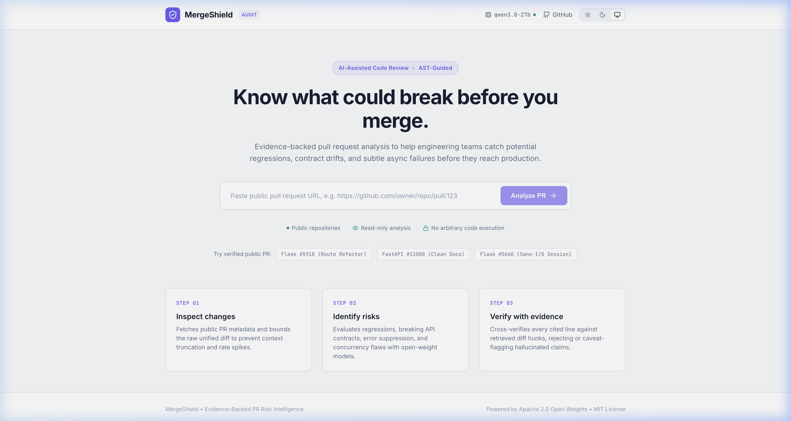
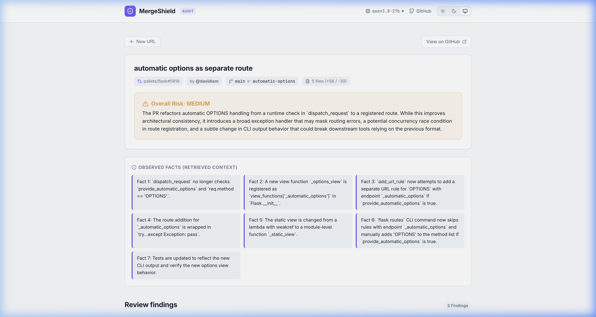

# 🛡️ MergeShield

> **Evidence-Backed PR Risk Intelligence & Diff Grounding**  
> An open-source, automated auditor for public GitHub Pull Requests powered by hosted open-weight models.

[](LICENSE)
[](https://python.org)
[](https://fastapi.tiangolo.com)
[](https://vitejs.dev)
[](https://www.apache.org/licenses/LICENSE-2.0)

---

## 🎯 Problem Statement & Solution

### The Problem
Code reviewers are overwhelmed by pull requests under tight sprint deadlines. While generic AI coding assistants offer conversational summaries, they frequently suffer from **critical shortcomings**:
1. **Hallucinated findings**: Claiming bugs exist on lines of code that were never touched or don't exist.
2. **Missing evidence**: Highlighting vague concerns ("concurrency issue") without citing exact hunk diffs or line ranges.
3. **No test guidance**: Leaving reviewers to manually write reproduction steps to confirm whether a flagged risk is valid.

### The Solution: MergeShield
MergeShield ingests a public GitHub Pull Request URL, fetches its live metadata and bounded diff via the GitHub REST API, and uses an open-weight foundation model (`qwen/qwen3.8-27b`) with strict prompt contracts. 

Crucially, **every finding must be grounded in diff evidence**: the backend cross-references model citations against actual unified diff lines. If a line is ungrounded or absent, MergeShield flags it with an explicit unverified caveat.

---

## 🖼️ Application Interface

| Light Mode (Clean Studio Aesthetic) | Dark Mode (Deep Charcoal & Violet) |
| :---: | :---: |
|  |  |

### Evidence-Backed Risk Report


---

## ✨ Features & Limitations

### Core Features
- **Public PR Fetching**: Ingests public GitHub PR URLs with SSRF protection, strict URL parsing, and GitHub rate limit auto-detection.
- **Bounded Diff Ingestion**: Imposes hard byte (200 KB) and line (1,500 lines) bounds to protect against token exhaustion and buffer bloat.
- **Hosted Open-Weight Reasoning**: Leverages `qwen/qwen3.8-27b` under the **Apache 2.0 License** via Groq Cloud for ultra-fast, reproducible structured JSON analysis.
- **Deterministic Evidence Grounding**: Validates that cited code snippets and line numbers exist in the modified diff hunks.
- **Change Impact Map**: Identifies touched file categories (API, Auth, Config, Database, Tests) and directly visible interface modifications.
- **Explainable Risk Prioritization**: Separates Potential Severity from Evidence Strength (`Verified in Diff`, `Plausible`, `Speculative`) and explains urgency rationale in plain English.
- **Smart Verification Planner**: Generates structured unit/integration/manual review test scenarios grounded in the diff without claiming execution.
- **Reviewer-Ready Report Export**: One-click download of an evidence-backed, sanitized `.md` report for PR comments and audit records.
- **Google Stitch-Inspired UI**: Responsive, accessible developer interface with light/dark/system theme support, collapsible cards, and one-click diff copying.

### Known Limitations
- **Public Repositories Only**: Current release is read-only for public GitHub pull requests; private enterprise repositories require configuring a GitHub personal access token with appropriate scopes.
- **Bounded Scope**: PR diffs exceeding 1,500 lines or 200 KB are truncated to ensure deterministic model latency; full monorepo diffs should be reviewed in sub-components.
- **Static Reasoning**: MergeShield provides static heuristic & LLM analysis; it does not execute repository code or run the project's test suite directly.

---

## 🤖 Model & License Provenance

| Component | Identifier / Source | License | Role |
| :--- | :--- | :--- | :--- |
| **Application Source** | MergeShield Repository | [MIT License](LICENSE) | Full-stack application & harness |
| **Foundation Model** | `qwen/qwen3.8-27b` | [Apache 2.0](https://www.apache.org/licenses/LICENSE-2.0) | Open-weight reasoning engine |
| **Model Hosting** | Groq Cloud API | Provider API Terms | Fast inference inference engine |
| **Alternative Models** | `llama-3.3-70b-versatile`, `openai/gpt-oss-120b` | Respective Open Licenses | Configurable fallback options |

> **Note on Model Licensing**: `qwen/qwen3.8-27b` is released under the OSI-approved **Apache 2.0 License**, granting commercial and non-commercial redistribution and modification rights. The MergeShield application itself is distributed under the **MIT License**.

---

## 📐 System Architecture

```
┌────────────────────────────────────────────────────────┐
│               React + Vite Frontend (Port 5173)         │
│   • Stitch-inspired UI (Light / Dark / System themes)   │
│   • Collapsible risk cards & verification checklist     │
└───────────────────────────┬────────────────────────────┘
                            │ HTTP POST /api/analyze
┌───────────────────────────▼────────────────────────────┐
│              FastAPI Backend Service (Port 8000)       │
│                                                        │
│  ┌──────────────────────────────────────────────────┐  │
│  │ 1. GitHub Client & SSRF Validator                │──┼──► GitHub REST API
│  │    • Validates github.com/owner/repo/pull/id     │  │    (Public PRs)
│  │    • Bounds diffs to 1,500 lines / 200 KB        │  │
│  └────────────────────────┬─────────────────────────┘  │
│                           │ Bounded Diff               │
│  ┌────────────────────────▼─────────────────────────┐  │
│  │ 2. Unified Diff Parser & Line Classifier         │  │
│  │    • Hunk extraction and exact line indexing     │  │
│  │    • Distinguishes changed lines from context    │  │
│  └────────────────────────┬─────────────────────────┘  │
│                           │ Structured Code Context    │
│  ┌────────────────────────▼─────────────────────────┐  │
│  │ 3. Open-Weight Model Adapter                     │──┼──► Hosted Groq API
│  │    • Structured JSON schema enforcement          │  │    (Qwen 3.8 27B)
│  │    • Strict anti-hallucination prompt contract   │  │
│  └────────────────────────┬─────────────────────────┘  │
│                           │ Raw Risk Findings          │
│  ┌────────────────────────▼─────────────────────────┐  │
│  │ 4. Grounding & Evidence Verifier                 │  │
│  │    • Verifies snippet matches parsed diff lines  │  │
│  │    • Injects explicit caveats for ungrounded code│  │
│  └──────────────────────────────────────────────────┘  │
└────────────────────────────────────────────────────────┘
```

---

## 🚀 Step-by-Step Local Setup

### Prerequisites
- **Python 3.11+**
- **Node.js 18+** and **npm**
- **Git**
- A **Groq API Key** (free tier at [console.groq.com](https://console.groq.com)) or compatible OpenAI endpoint.

### 1. Clone & Configure Environment
```bash
git clone https://github.com/Sachinva-karma/mergeshield.git
cd mergeshield

# Copy example environment configuration
cp .env.example .env
```

Edit `.env` safely (never commit this file):
```env
MODEL_PROVIDER=groq
MODEL_NAME=qwen/qwen3.8-27b
GROQ_API_KEY=gsk_your_actual_groq_api_key_here

# Optional: increase GitHub rate limit if desired
# GITHUB_TOKEN=ghp_your_github_token_here
```

### 2. Backend Setup & Startup
In your first terminal:
```bash
cd backend
python3 -m venv .venv
source .venv/bin/activate
pip install -r requirements.txt

# Start backend on port 8000
PYTHONPATH=. uvicorn app.main:app --host 0.0.0.0 --port 8000 --reload
```

Verify backend health:
```bash
curl http://localhost:8000/api/health
# Response: {"status":"healthy","model_configured":true,"model_name":"qwen/qwen3.8-27b"}
```

### 3. Frontend Setup & Startup
In a second terminal:
```bash
cd frontend
npm install

# Start Vite development server on port 5173
npm run dev
```

Open **[http://localhost:5173](http://localhost:5173)** in your browser.

---

## 🧪 Running Automated Tests

Run the backend test suite:
```bash
PYTHONPATH=backend backend/.venv/bin/pytest backend/tests -v
```

The 17 automated tests validate:
- **SSRF & URL Security**: Blocks malformed hosts, internal IPs, AWS metadata endpoints, and non-PR URLs.
- **Diff Bounding & Truncation**: Ensures oversized diffs are safely capped.
- **Diff Parsing & Line Grounding**: Tests hunk line mapping and changed vs context line indexing.
- **Evidence Verification**: Validates detection of grounded code and flagging of hallucinated snippets.
- **Model Adapter Robustness**: Handles 429 rate limits, empty responses, and markdown-wrapped JSON.
- **Open-Source License Provenance**: Verifies Apache 2.0 classification for Qwen open weights.

Run the frontend production build:
```bash
cd frontend
npm run build
```

---

## 💡 Example Usage & Tested PRs

You can test MergeShield using real open-source pull requests:

| Repository & PR | Description | Tested Result |
| :--- | :--- | :--- |
| [`pallets/flask #5918`](https://github.com/pallets/flask/pull/5918) | Automatic OPTIONS route refactor | `MEDIUM` risk: flags broad exception masking and route registration race condition. 100% diff-grounded. |
| [`fastapi/fastapi #11000`](https://github.com/fastapi/fastapi/pull/11000) | Documentation & typing patch | `LOW` risk: verifies minimal surface area and changes. |

### API Curl Example
```bash
curl -X POST http://localhost:8000/api/analyze \
  -H "Content-Type: application/json" \
  -d '{"pr_url": "https://github.com/pallets/flask/pull/5918"}'
```

---

## 🛠️ Troubleshooting & FAQ

1. **Error: "Model provider credentials not configured" (503)**
   - Verify that your `.env` contains `GROQ_API_KEY=gsk_...` without quotes or trailing spaces.
   - Restart the backend uvicorn process to reload `.env`.

2. **Error: "GitHub API rate limit exceeded" (429)**
   - Unauthenticated GitHub API calls are capped at 60 requests/hour per IP.
   - Add `GITHUB_TOKEN=...` in your `.env` or authenticate with `gh auth login` to raise limits to 5,000 requests/hour.

3. **Frontend fails to connect to backend**
   - Ensure the backend is running on `http://localhost:8000`. The Vite frontend dev server proxies all `/api` requests to port 8000 automatically.

---

## 🤝 Contributing

Contributions are welcome!
1. Fork the repository.
2. Create your feature branch (`git checkout -b feat/my-feature`).
3. Ensure all tests pass (`PYTHONPATH=backend pytest backend/tests`).
4. Commit your changes (`git commit -am 'feat: add feature'`).
5. Push to the branch (`git push origin feat/my-feature`).
6. Open a Pull Request.

---

## 📄 License

- **MergeShield Application**: [MIT License](LICENSE) © 2026 MergeShield Contributors.
- **Default AI Model**: [Apache 2.0 License](https://www.apache.org/licenses/LICENSE-2.0) (`qwen/qwen3.8-27b` by Alibaba Qwen team).
